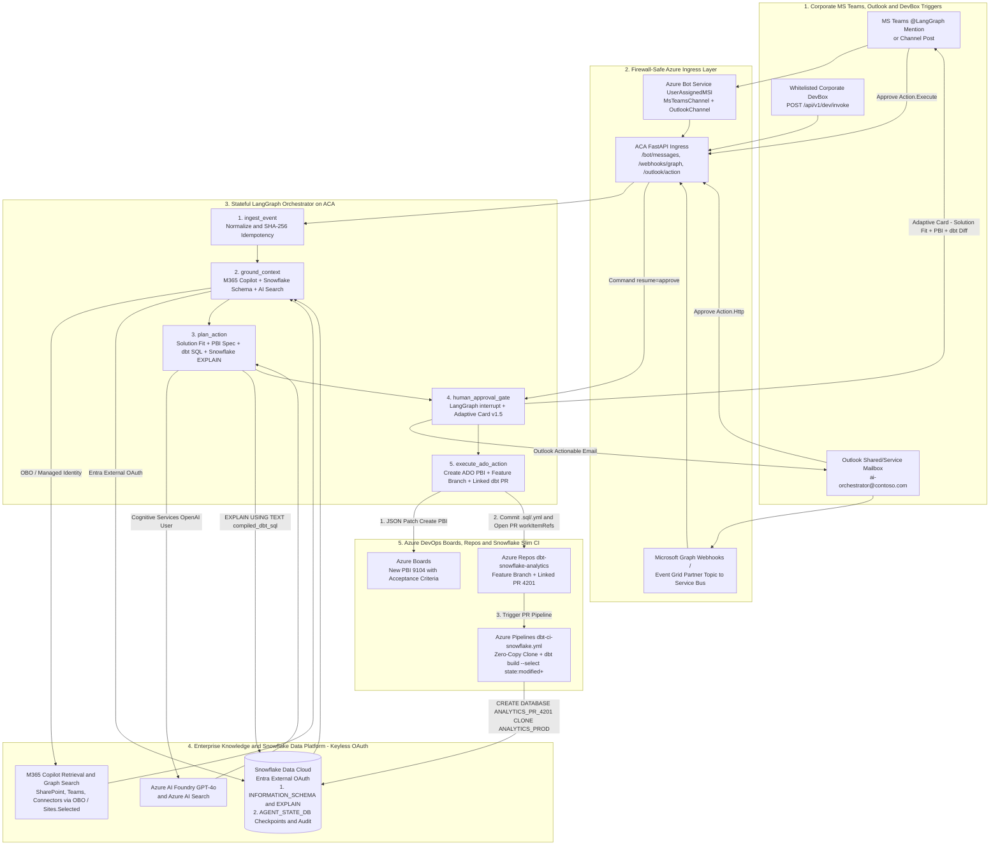
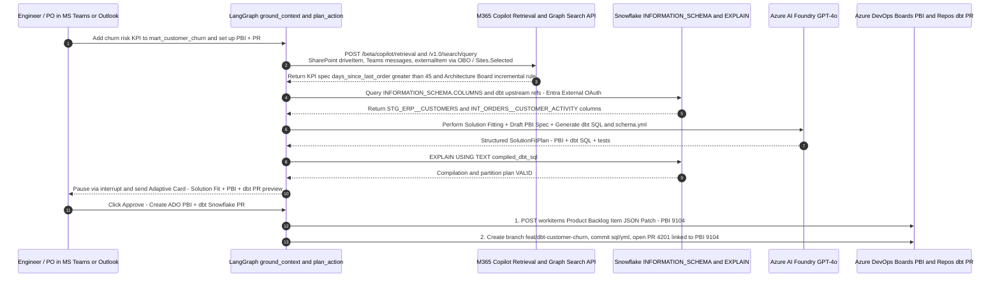

# Architectural Blueprint: MS Teams & Outlook -> M365 Copilot Grounding -> LangGraph -> dbt/Snowflake & Azure DevOps PBI/PR

This document details the complete enterprise architecture across five pillars:
1. **Corporate MS Teams & Outlook Trigger Patterns Across Firewalls**
2. **M365 Copilot Knowledge Grounding & Request-to-Solution Fitting**
3. **dbt + Snowflake Keyless External OAuth, Pre-Flight `EXPLAIN`, and Slim CI**
4. **DevBox & VNet Network Isolation (`ipSecurityRestrictions` + Private Link)**
5. **100% Keyless Entra ID Authentication Matrix (Zero Secrets)**

---

## 1. End-to-End Flow: Teams/Outlook Trigger -> M365 Copilot & Snowflake Grounding -> PBI + dbt PR

GitHub Mobile — end-to-end flow outline

1. Teams / Outlook / DevBox triggers → Bot Service or Graph/Event Grid → ACA FastAPI
2. LangGraph: ingest_event → ground_context → plan_action → human_approval_gate → execute_ado_action
3. Grounding: M365 Copilot (OBO) + Snowflake External OAuth + AI Foundry
4. Execution: Azure Boards PBI + dbt feature PR + slim CI zero-copy clone

---

## 2. Solving the Corporate MS Teams & Outlook Trigger Problem Across Firewalls

In locked-down enterprise networks, exposing an unauthenticated public webhook on Azure Container Apps is forbidden, and Microsoft Graph subscriptions expire every **1 to 3 days**. This repository implements three complementary patterns in `infra/modules/triggers.bicep` and `src/app/services/`:

| Pattern | How It Reaches ACA Across Firewalls | Best Use Case | Files in Repo |
| :--- | :--- | :--- | :--- |
| **Pattern A: Graph -> Event Grid Partner Topic -> Service Bus Queue (`q-teams-outlook-triggers`)** | Microsoft Graph pushes events inside Microsoft's backbone to an **Azure Event Grid Partner Topic**, which forwards to **Azure Service Bus** (`disableLocalAuth: true`). ACA pulls messages outbound over Private Endpoint / VNet — **zero public inbound webhook required!** | Zero-Trust Production (`acaExternalIngress = false`) for watching Teams channels & Outlook mailboxes (`ai-orchestrator@contoso.com`). | `infra/modules/triggers.bicep`, `src/app/services/graph_subscriptions.py` |
| **Pattern B: Direct Graph Webhooks + Lifecycle Auto-Renewal** | FastAPI exposes `/api/v1/webhooks/graph` and `/api/v1/webhooks/graph/lifecycle`, verifies `clientState` + Graph OIDC JWT signatures, returns `HTTP 202 Accepted` in `<200ms`, and automatically patches subscription expiration on `reauthorizationRequired`. | Rapid Dev/Staging setup with Azure Front Door or Graph CIDR whitelisting. | `src/app/main.py`, `src/app/services/graph_subscriptions.py` |
| **Pattern C: Keyless Single-Tenant Azure Bot Service (`UserAssignedMSI`) + Outlook Actionable Messages** | Azure Bot Service (`Microsoft.BotService/botServices`) is configured with `msaAppType: 'UserAssignedMSI'` bound to the **same ACA User-Assigned Managed Identity** (zero client secrets!). Supports `@LangGraph Architect` in Teams and interactive Adaptive Card `Action.Execute` / `Action.Http` callbacks in both Teams and Outlook. | Interactive `@mentions` in MS Teams and 1-click Adaptive Card approvals in Teams & Outlook. | `infra/modules/triggers.bicep`, `teams-app/manifest.json`, `src/app/services/teams_outlook_ingress.py` |

---

## 3. Connecting Company Knowledge from Microsoft 365 Copilot for Solution Fitting & PBI Setup

When a request arrives from MS Teams or Outlook (e.g., *"Add a customer churn risk indicator to our customer mart"*), the orchestrator needs the same company context that employees access in **Microsoft 365 Copilot** (SharePoint specs, Architecture Decision Records, Teams channel discussions, and Confluence/Jira items ingested via Graph Connectors) plus technical **Snowflake/dbt** metadata.

GitHub Mobile — sequence outline

Engineer asks in Teams/Outlook → LangGraph grounds in M365 Copilot Retrieval + Graph Search (OBO) → Snowflake INFORMATION_SCHEMA → Solution Fit + PBI + dbt SQL → EXPLAIN USING TEXT compiled_dbt_sql → Adaptive Card HITL → ADO PBI 9104 + PR 4201.

### Dual Security Mode for M365 Copilot Grounding (`src/app/services/m365_copilot_grounding.py`)
1. **Interactive Teams / DevBox Trigger (Delegated On-Behalf-Of `OBO`)**:
   - Exchanges the caller's inbound Entra token for a Microsoft Graph token via Federated Identity Credential OBO.
   - M365 Copilot Retrieval API (`/beta/copilot/retrieval`) and Graph Search (`/v1.0/search/query`) automatically enforce the exact SharePoint and Teams ACLs of the person who asked the question.
2. **Unattended Shared Mailbox Trigger (Application `Sites.Selected`)**:
   - Uses the ACA User-Assigned Managed Identity scoped to curated architecture and data-governance SharePoint sites via `Sites.Selected` (avoiding tenant-wide `Sites.Read.All`).

---

## 4. End-to-End Keyless Authentication Matrix (Azure + M365 + Snowflake + Azure DevOps)

| Source Hop | Target Service | Entra Token Scope (`resource`) | Required Role / Permission Assignment | Code / IaC Location |
| :--- | :--- | :--- | :--- | :--- |
| **GitHub Actions / ADO Pipeline** | Azure Resource Manager | `https://management.azure.com/.default` | Federated Identity Credential (OIDC) + `Contributor` on Resource Group | `.github/workflows/deploy-infra-and-app.yml`, `.azure-pipelines/azure-pipelines.yml` |
| **FastAPI / LangGraph & ADO CI** | **Snowflake Data Cloud** | `api://<snowflake-entra-resource-id>/.default` | Snowflake `SECURITY INTEGRATION (TYPE = EXTERNAL_OAUTH)` mapping UAMI `oid` to `SVC_ACA_LANGGRAPH` (`RL_LANGGRAPH_AGENT`) | `infra/snowflake/entra_external_oauth_setup.sql`, `src/app/services/snowflake_dbt.py` |
| **FastAPI / LangGraph** | **M365 Copilot & Graph Search** | `https://graph.microsoft.com/.default` | Delegated `Files.Read.All`, `Sites.Read.All`, `ChannelMessage.Read.All`, `ExternalItem.Read.All` (OBO) or Application `Sites.Selected`, `Mail.Read` | `src/app/services/m365_copilot_grounding.py` |
| **Azure Bot Service** | **MS Teams & Outlook Channels** | `UserAssignedMSI` (`id-lgorchestrator`) | Bot resource configured with `msaAppType: 'UserAssignedMSI'` & `msaAppMSIResourceId` (Zero client secrets) | `infra/modules/triggers.bicep`, `teams-app/manifest.json` |
| **ACA Worker / Event Grid** | **Azure Service Bus** | `https://servicebus.azure.net/.default` | `Azure Service Bus Data Receiver` & `Sender` (`disableLocalAuth: true`) | `infra/modules/triggers.bicep` |
| **FastAPI / LangGraph** | **Azure AI Foundry & AI Search** | `https://cognitiveservices.azure.com/.default` | `Cognitive Services OpenAI User` & `Search Index Data Reader` (`disableLocalAuth: true`) | `infra/modules/ai.bicep`, `src/app/graph/orchestrator.py` |
| **FastAPI / LangGraph** | **Azure DevOps (Boards + Repos + Pipelines)** | `499b84ac-1321-427f-aa17-267ca6975798/.default` | UAMI added to ADO Organization as Service Principal (`Project Contributors`; creates PBIs, feature branches & linked PRs) | `src/app/services/ado_client.py` |
